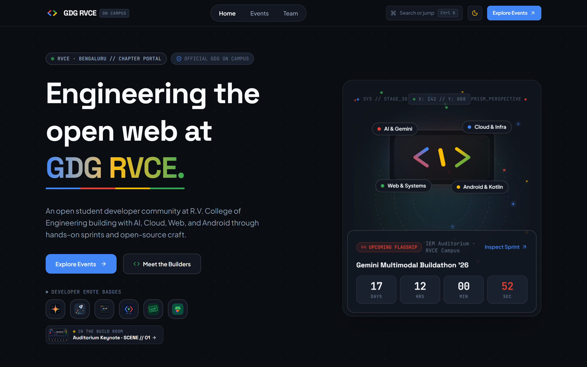
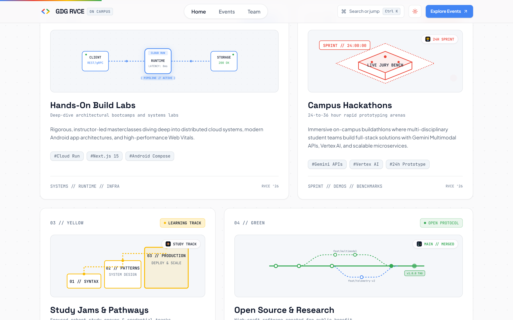
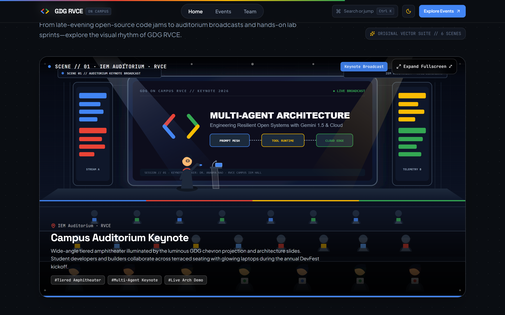
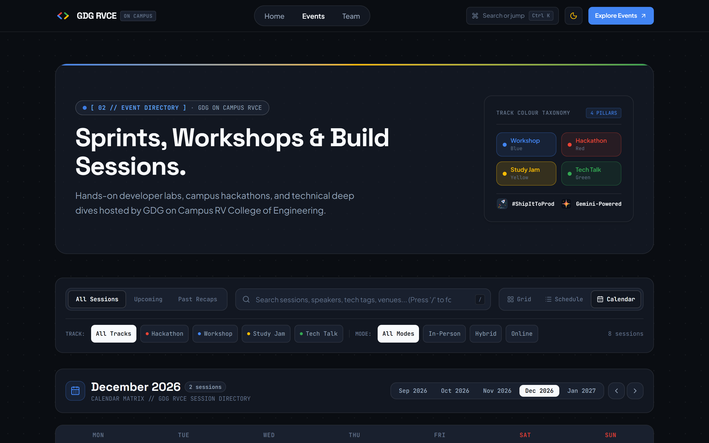
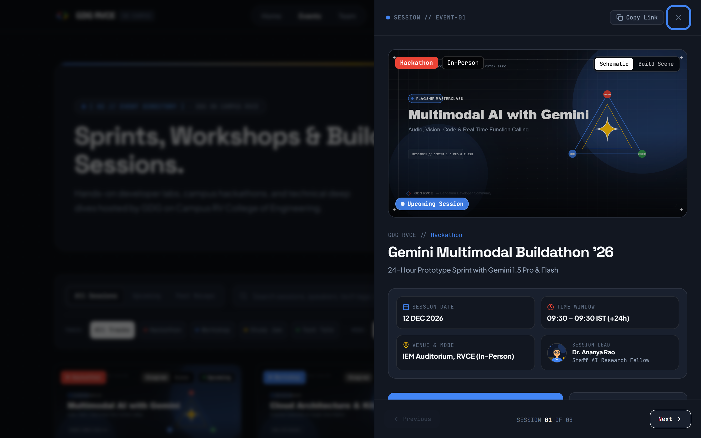
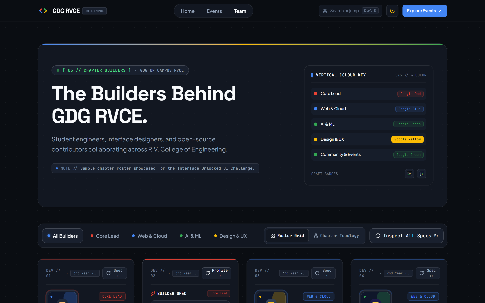
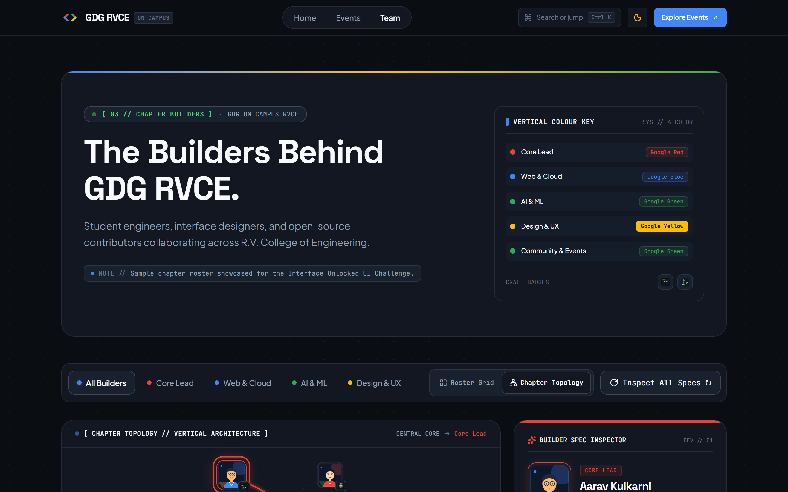
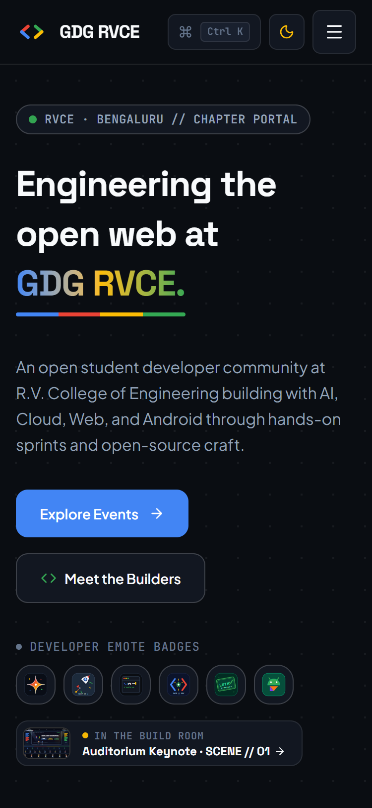

# GDG on Campus RV College of Engineering (GDG RVCE)
## Interface Unlocked UI Design Challenge

[](https://nextjs.org/)
[](https://react.dev/)
[](https://tailwindcss.com/)
[](https://www.typescriptlang.org/)
[](https://www.w3.org/WAI/standards-guidelines/wcag/)
[](https://opensource.org/licenses/MIT)

---

### 🌐 Live Deployment & Repository Links
* **Live Deployed Website:** [https://gdg-rvce-interface-unlocked.vercel.app](https://gdg-rvce-interface-unlocked.vercel.app)  
  *(Note: Update URL if deployed to a custom Vercel preview or custom production host).*
* **Public GitHub Repository:** [https://github.com/Code-with-Prabhjot/gdg-rvce-interface-unlocked](https://github.com/Code-with-Prabhjot/gdg-rvce-interface-unlocked)

---

## 📐 Project Description & Design Direction

Crafted for the **Interface Unlocked UI Design Challenge**, this web application is the official digital platform for **GDG on Campus RV College of Engineering (GDG RVCE)**.

Rather than recycling generic corporate SaaS templates or superficial glassmorphic cards, the design is grounded in an **"Architectural Blueprint & Kinetic Canvas"** philosophy. Inspired by Swiss graphic design, engineering drafting schematics, and code-native IDE ergonomics, the interface reflects RVCE’s renowned technical culture and rigor.

### Core Architectural Foundations:
1. **Precision Dual-Theme Engine:**
   - **Obsidian IDE (`dark` mode):** A deep `#0A0D12` developer editor palette accented by vivid Google brand light emitters, terminal command inputs, and laser-sharp hairlines. Features zero-flash synchronous client boot.
   - **Daylight Blueprint (`light` mode):** An architectural drafting table `#FAFAFB` canvas with 32px blueprint coordinate grid lines, technical dimension indicators, and tactile ink contrast.
2. **Strict Brand Compliance & Community Independence:**
   - Faithful execution of the official **Google Developer Groups `< >` chevron emblem** with verified geometric proportions and isolated breathing room.
   - Universal semantic deployment of the **4 official Google brand colours**:
     - **Blue (`#4285F4`):** Core technical workshops, architecture deep dives, and primary navigation states.
     - **Red (`#EA4335`):** Flagship hackathons, live sprint badges, campus geolocation pins, and urgent countdowns.
     - **Yellow (`#FBBC04`):** Study jams, community keynotes, and sprint badges. Critically, to eliminate low-contrast accessibility failures, yellow fills are universally mapped to `#111827` dark ink, securing **>7:1 WCAG AAA** contrast.
     - **Green (`#34A853`):** Open-source builds, CI/CD telemetry, verified pass badges, and Git status indicators.
   - Explicit independence disclaimer in the global footer: *"GDG on Campus RVCE is an independent student developer community and is not an official Google product."*
3. **Ground-Rule Integrity:**
   - **Exact Route Scope:** Exclusively the 3 mandated pages (`/` Home, `/events` Events & Sprints, `/team` Core Team) plus `not-found.tsx` under `src/app/`.
   - **Zero Prohibited Trackers:** Strictly no analytics counters, no RSVP / interest counters (`"X people going"`), no attendee rosters, no live comment feeds, and no chat widgets.
   - **100% Fictional Data:** All speakers, agenda schedules, and team specs are curated fictional samples.

---

## 📸 Visual Showcase (Production Screenshots)

The following 8 high-resolution production screenshots showcase the flagship user experiences built across the application:

| Desktop Experience & Stage (Obsidian Dark) | Bento Pillars & Learning Tracks (Daylight Light) |
|---|---|
| <br><sub>**01. Home Page Hero (Obsidian IDE Dark Mode)**<br>Kinetic Split Hero, 3D GDG `< >` Prism Stage, HTML5 Constellation Canvas, and Live Countdown HUD.</sub> | <br><sub>**02. Bento Pillars & Tracks (Daylight Blueprint Light Mode)**<br>4-Pillar Architectural Bento Grid (AI/ML, Cloud, Android, Web) and Interactive Learning Tracks Explorer.</sub> |
| **Editorial Community Scenes & Filmstrip** | **Events Calendar Matrix View** |
| <br><sub>**03. Editorial Community Scenes Cinema Frame (Dark Mode)**<br>In the Build Room cinema frame, 6-tile interactive filmstrip, and full-resolution lightbox viewer.</sub> | <br><sub>**04. Events Calendar Matrix View (Dark Mode)**<br>Month-by-month session matrix with colour-coded Google track pills and instant `/` search bar.</sub> |
| **Deep-Dive Event Detail Drawer** | **Team Roster & Builder Specs** |
| <br><sub>**05. Event Detail Drawer (`/events?event=...`)**<br>Slide-over drawer with 4-colour agenda timeline, Schematic/Scene artwork switcher, and `.ics` / `.png` pass actions.</sub> | <br><sub>**06. Core Team Roster & Builder Spec**<br>Vertical department filters, Bauhaus developer portraits, and flipped card showing live competency telemetry.</sub> |
| **Chapter Circuit Topology View** | **Mobile Responsive Verification** |
| <br><sub>**07. Interactive Chapter Topology Graph**<br>Central GDG `< >` Core Hub circuit node graph, reactive connection pulses, and Live Builder Inspector.</sub> | <br><sub>**08. Mobile Responsive Layout (`375x812`)**<br>Pixel-perfect mobile typography, touch-friendly tap targets, and zero horizontal overflow (`320px`–`2560px`).</sub> |

---

## ⚡ Complete Feature Breakdown Across the 3 Mandated Pages

### 1. Home Page (`/`)
* **Sub-Second `< >` Prism Boot Sequence:** Architectural boot loader initializing developer telemetry, session storage caching (`sessionStorage.getItem('gdg-rvce-boot-seen')`), and graceful exit.
* **Interactive HTML5 Constellation Canvas:** High-performance particle physics engine reacting to cursor proximity with Google 4-colour connection filaments.
* **3D Mouse-Tilt GDG Prism Stage:** Geometric `< >` chevron floating stage with real-time perspective distortion (`rotateX`, `rotateY`, dynamic specular glares) driven by mouse pointer velocity.
* **Live Flagship Sprint Countdown HUD:** High-contrast countdown timer ticking live towards RVCE's next flagship buildathon with microsecond precision.
* **Campus Telemetry & Tech Marquee Bar:** Real-time engineering telemetry bar featuring RVCE GPS coordinates (`12.9237° N, 77.4987° E`), active build cycle, and infinite marquee of modern tools (Gemini 2.5 Pro, Firebase Genkit, Vertex AI, Ktor, Jetpack Compose).
* **4-Pillar Architectural Bento Grid:** Interactive architectural modules exploring GDG RVCE's four disciplines—AI/ML, Cloud & DevOps, Android & Mobile, and Web & Open Source—with interactive developer sticker badges.
* **Interactive 4-Vertical Learning Tracks Explorer:** Tabbed curriculum navigator with prerequisite trees, difficulty ratings, and recommended tooling.
* **Featured Upcoming Sprints Showcase:** High-priority sprint cards with real-time delivery mode badges and one-click drawer inspection.
* **Community Build Room Filmstrip & Lightbox:** Six bespoke editorial community scenes showcasing RVCE hackathon build nights, pair programming, and keynote sessions with an interactive lightbox viewer.
* **Multi-Tab Recap Spotlight:** Community recap highlighting previous DevFest keynotes, open-source milestones, and student project ship logs.
* **Desktop Scroll-Spy Telemetry Rail:** Fixed vertical waypoint navigation rail for ultra-wide displays (2XL+) with live active-section highlighting.

### 2. Events & Sprints Directory (`/events`)
* **Real-Time `/` Instant Search:** Keyboard-shortcut-focused input filtering titles, topics, speakers, and venues without layout thrashing.
* **Multi-Axis Filter Bar:** Simultaneous filtering by Event Status (*All, Upcoming, Past*), Technology Track (*Hackathon, Workshop, Study Jam, Tech Talk*), and Delivery Mode (*In-Person, Hybrid, Online*).
* **Three Flexible View Modes:**
  - **Grid View:** Architectural 16:9 vector illustration cards with metadata tags and action triggers.
  - **Schedule List View:** Chronological schedule stream optimized for rapid scanning.
  - **Calendar Matrix View:** Full monthly grid with colour-coded Google track sessions and interactive day cells.
* **Bidirectional URL Query Sync:** Filters and selected event slugs sync bidirectionally with the browser URL (`/events?event=...&track=...&status=...&mode=...`), enabling seamless sharing and bookmarking.
* **Deep-Dive Event Detail Drawer:**
  - **Schematic / Scene Artwork Switcher:** Toggle between technical architecture schematics and editorial build room scenes.
  - **4-Colour Agenda Timeline:** Micro-stepper rendered in Google Blue, Red, Yellow, and Green.
  - **Interactive Readiness Checklist:** Local browser-persisted checklist ensuring attendees prepare their dev environment before arriving.
  - **Client-Side `.ics` Calendar Export:** One-click instant calendar export generating RFC 5545-compliant iCalendar files.
  - **High-DPI `.png` Sample Pass Generator:** Canvas-rendered printable event pass with simulated QR verification.

### 3. Core Team Directory (`/team`)
* **Vertical Department Filter Bar:** Filter builders by engineering vertical (*All Builders, Chapter Leads, Machine Learning, Cloud & Infrastructure, Mobile & Edge, Systems & Open Source*).
* **Dual-Sided Tactile Builder Cards:**
  - **Front (Profile):** Custom Bauhaus geometric vector portraits, academic year and branch, role badges, and social links.
  - **Back (Builder Spec ↻):** Flipped view revealing technical stacks (e.g., Python, JAX, PyTorch), active projects, and animated competency telemetry bars.
* **Interactive Ephemeral Emote Pop Bursts:** Floating developer reaction particle bursts (8 developer emotes v2) on hover and click.
* **Interactive Chapter Circuit Topology View:**
  - Dynamic node graph showing the central GDG `< >` Core Hub connected to department nodes.
  - Pulsing circuit traces and live builder inspector panel with competency breakdowns.
* **Open Build Workflow Strip:** Four-step engineering workflow documenting how RVCE student contributors propose, prototype, review, and ship open-source software.

### 4. Developer Craft & Universal Accessibility
* **`⌘K` / `Ctrl+K` Command Palette:** Fuzzy command execution for rapid page navigation, theme toggling, quick search, and confetti celebrations.
* **`` ` `` / `~` Interactive Developer CLI Terminal:** Quake-style drop-down terminal executing commands (`help`, `clear`, `theme`, `events`, `team`, `coords`, `status`).
* **Physics-Based Spring Micro-Interactions:** Magnetic button pulls, smooth scale damping, and tactile `:active` states.
* **Universal Keyboard Navigation & WCAG AAA Compliance:** Every interactive element features high-visibility `:focus-visible` rings and explicit ARIA labels.
* **`prefers-reduced-motion` Support:** Automatically disables heavy parallax, particle physics, and layout flips for users who prefer minimal motion.

---

## 🛠️ Technologies Used & Local Asset Studio

| Layer | Technology | Purpose |
|---|---|---|
| **Framework** | **Next.js 15.5 (App Router)** | Server Components, static site pre-rendering, route-level metadata |
| **Library** | **React 19.1** | Modern hook architecture, concurrent UI transitions |
| **Language** | **TypeScript 5** | Strict type safety, strict interface contracts for all data structures |
| **Styling** | **Tailwind CSS v4** | CSS variables, container queries, high-performance styling engine |
| **Motion** | **Framer Motion 14** | Spring physics, layout animations, gestures, and drawer transitions |
| **Icons** | **Lucide React & Phosphor Icons** | Clean, accessible developer and system iconography |
| **Visual Assets** | **Node.js SVG Asset Studio** | 45 bespoke vector assets generated via `scripts/generate-visual-assets.mjs` |
| **Effects** | **Canvas Confetti** | Google 4-colour particle celebrations |

### 🎨 The Local Vector Asset Studio
All visual assets in the application are 100% self-contained, lightweight vector graphics authored programmatically through `scripts/generate-visual-assets.mjs`:
- **1 Official GDG Mark:** Programmatically scaled `< >` chevron logo (`public/assets/brand/gdg-mark.svg`).
- **10 Bauhaus Developer Avatars:** Geometric profile portraits for the core chapter leads (`public/assets/avatars/`).
- **8 Event Covers:** 16:9 technical schematics for hackathons, study jams, and cloud labs (`public/assets/covers/`).
- **20 Developer Emotes:** High-contrast reaction badges and sticker icons (`public/assets/emotes/`).
- **6 Community Scenes:** Rich editorial illustrations depicting build rooms, keynotes, and sprint sessions (`public/assets/scenes/`).

---

## 🚀 Local Setup & Build Instructions

### 1. Clone the Repository
```bash
git clone https://github.com/Code-with-Prabhjot/gdg-rvce-interface-unlocked.git
cd gdg-rvce-interface-unlocked
```

### 2. Install Dependencies
```bash
npm install
```

### 3. Generate Local Vector Assets
Generate the 45 local, self-contained SVG assets:
```bash
npm run assets:build
```

### 4. Start Local Development Server
```bash
npm run dev
```
Open [http://localhost:3000](http://localhost:3000) in your browser.

### 5. Production Build & Lint Check
```bash
npm run lint
npm run build
npm run start
```

---

## 📜 Credits & Open-Source Attributions

* **Typography:**
  - [Space Grotesk](https://fonts.google.com/specimen/Space+Grotesk) by Florian Karsten (SIL Open Font License)
  - [Plus Jakarta Sans](https://fonts.google.com/specimen/Plus+Jakarta+Sans) by Tokotype (SIL Open Font License)
  - [JetBrains Mono](https://www.jetbrains.com/lp/mono/) by JetBrains (Apache License 2.0)
* **Iconography:**
  - [Lucide Icons](https://lucide.dev/) (ISC License)
  - [Phosphor Icons](https://phosphoricons.com/) (MIT License)
* **Animation & Visuals:**
  - [Framer Motion](https://www.framer.com/motion/) by Framer (MIT License)
  - [Canvas Confetti](https://github.com/catdad/canvas-confetti) by Kiril Vatev (ISC License)
* **Vector Art & Assets:**
  - All 45 vector illustrations, Bauhaus portraits, community scenes, and event covers were authored specifically for this submission via `scripts/generate-visual-assets.mjs`.

---

## ⚖️ Legal & Community Disclaimer
GDG on Campus RVCE is an independent student developer community at RV College of Engineering and is not an official Google product or corporate entity. Google Developer Groups, Google, and the Google logo are trademarks of Google LLC.
