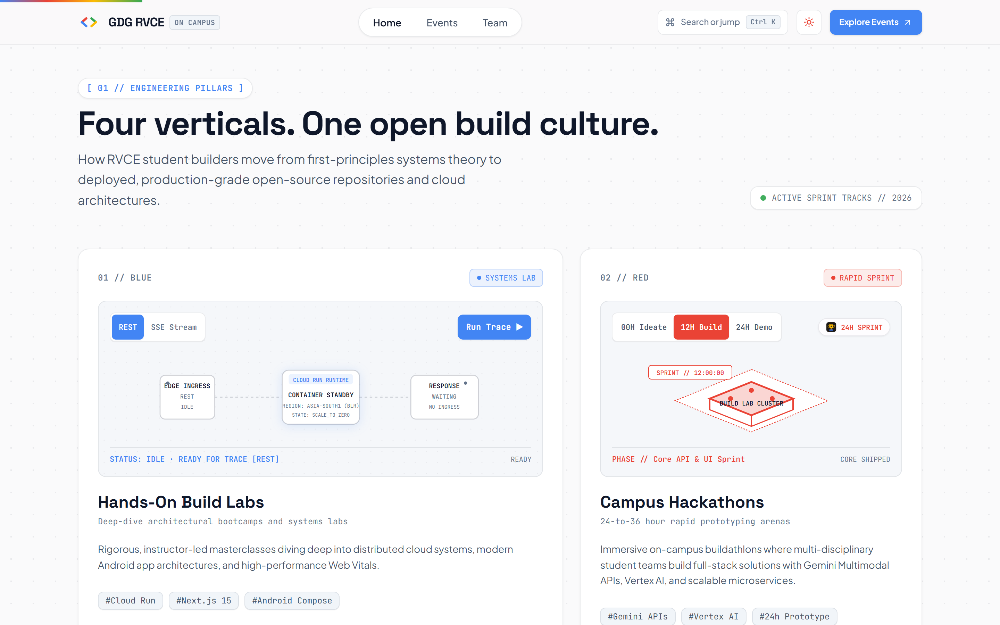
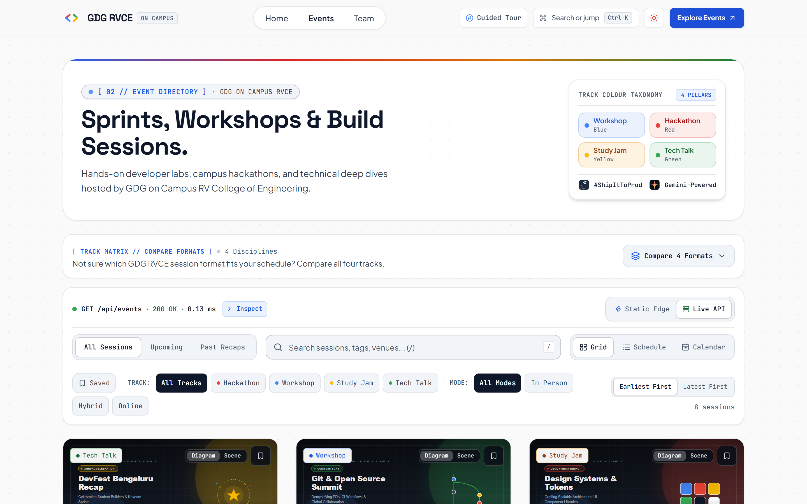
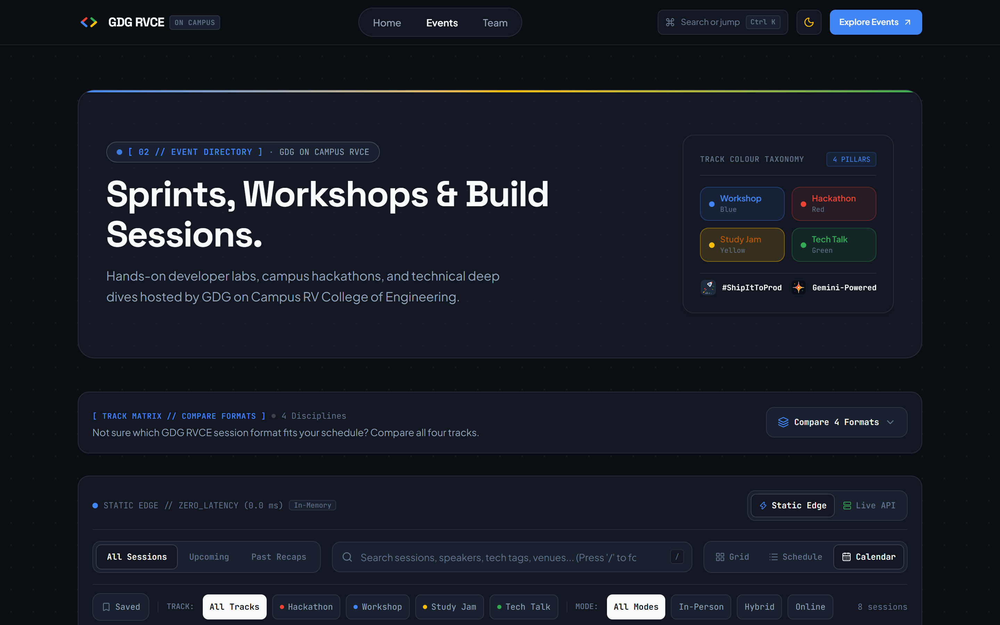
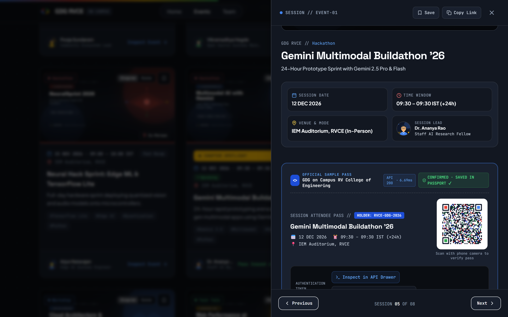
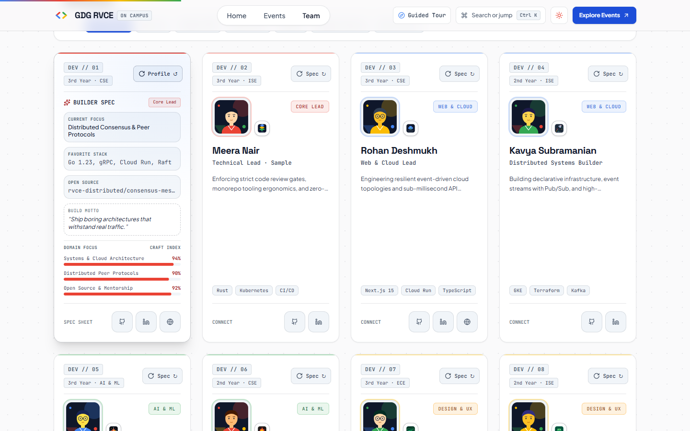
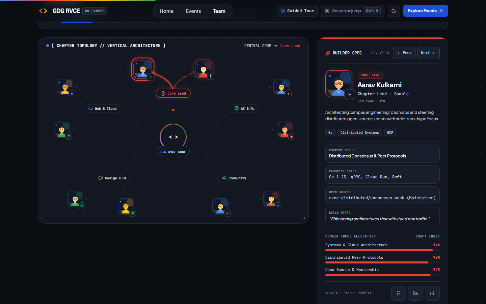
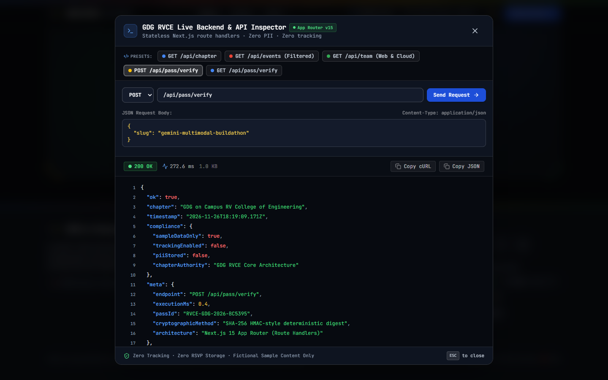
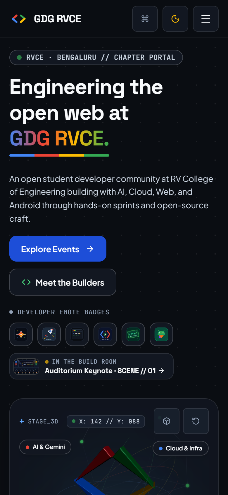

# GDG on Campus RV College of Engineering (GDG RVCE)
## Interface Unlocked UI Design Challenge

[](https://nextjs.org/)
[](https://react.dev/)
[](https://tailwindcss.com/)
[](https://www.typescriptlang.org/)
[](https://www.w3.org/WAI/standards-guidelines/wcag/)
[](https://opensource.org/licenses/MIT)

---

### 🌐 Live Deployment & Repository Links
* **Live Deployed Website:** [https://gdg-rvce-interface-unlocked.vercel.app](https://gdg-rvce-interface-unlocked.vercel.app)
* **Public GitHub Repository:** [https://github.com/Code-with-Prabhjot/gdg-rvce-interface-unlocked](https://github.com/Code-with-Prabhjot/gdg-rvce-interface-unlocked)

---

## 📐 Project Description & Design Direction

Crafted for the **Interface Unlocked UI Design Challenge**, this web application is the official digital collective and developer platform for **GDG on Campus RV College of Engineering (GDG RVCE)**.

Rather than recycling generic corporate SaaS templates or superficial glassmorphic cards, the design is grounded in an **"Architectural Blueprint & Kinetic Canvas"** philosophy. Inspired by Swiss graphic design, engineering drafting schematics, and code-native IDE ergonomics, the interface reflects RVCE’s renowned technical culture and engineering rigor.

### Core Architectural Foundations:
1. **Precision Dual-Theme Engine:**
   - **Obsidian IDE (`dark` mode):** A deep `#0A0D12` developer editor palette accented by vivid Google brand light emitters, terminal command inputs, and laser-sharp hairlines. Features zero-flash synchronous client boot.
   - **Daylight Blueprint (`light` mode):** An architectural drafting table `#FAFAFB` canvas with 32px blueprint coordinate grid lines, technical dimension indicators, and tactile ink contrast.
2. **Strict Brand Compliance & Community Independence:**
   - Faithful execution of the official **Google Developer Groups `< >` chevron emblem** with verified geometric proportions and isolated breathing room.
   - Universal semantic deployment of the **4 official Google brand colours**:
     - **Blue (`#4285F4`):** Core technical workshops, architecture deep dives, and primary navigation states.
     - **Red (`#EA4335`):** Flagship hackathons, live sprint badges, campus geolocation pins, and urgent countdowns.
     - **Yellow (`#FBBC04`):** Study jams, community keynotes, and sprint badges. Critically, to eliminate low-contrast accessibility failures, yellow fills are universally mapped to `#111827` dark ink, securing **>7:1 WCAG AAA** contrast.
     - **Green (`#34A853`):** Open-source builds, CI/CD telemetry, verified pass badges, and Git status indicators.
   - Explicit independence disclaimer in the global footer: *"GDG on Campus RVCE is an independent student developer community and is not an official Google product."*
3. **Stateless Next.js Backend, Security & Challenge Ground-Rule Integrity:**
   - **Exact Route Scope:** Exclusively the 3 user-facing pages (`/` Home, `/events` Events & Sprints, `/team` Core Team) plus `not-found.tsx`, `loading.tsx`, App Router metadata routes (`robots.ts`, `sitemap.ts`, `manifest.ts`, `opengraph-image.tsx`, `twitter-image.tsx`, `icon.svg`, `apple-icon.tsx`, multi-res `< >` `favicon.ico`), and 5 stateless Route Handlers (`/api/chapter`, `/api/events`, `/api/team`, `/api/pass/verify`, `/api/auth/demo`).
   - **HTTP Security & Technical SEO:** Strict security response headers (`Content-Security-Policy` with `frame-ancestors 'none'`, `X-Frame-Options: DENY`, `X-Content-Type-Options: nosniff`, `Referrer-Policy`, `Permissions-Policy`), unique canonical URLs, OpenGraph PNG cards, and zero internal environment leaks.
   - **Zero Prohibited Trackers:** Strictly no analytics counters, no RSVP / interest counters (`"X people going"`), no attendee rosters, no live comment feeds, and no chat widgets.
   - **100% Fictional Data:** All speakers, agenda schedules, and team specs are curated fictional samples.

---

## 📸 Visual Showcase (10-Screen Flagship Production Showcase)

The following 10 high-resolution production screenshots showcase the flagship user experiences, interactive developer simulators, and live diagnostic tools built across the application:

| Desktop Experience & Stage (Obsidian Dark) | Bento Simulators & Learning Tracks (Daylight Light) |
|---|---|
| <br><sub>**01. Home Page Hero (Obsidian IDE Dark Mode)**<br>Kinetic Split Hero, 3D GDG `< >` Prism Stage, HTML5 Constellation Canvas, and Live Countdown HUD.</sub> | <br><sub>**02. Bento Simulators & Tracks (Daylight Blueprint Light Mode)**<br>4-Pillar Architectural Bento Grid with live interactive simulators (Gemini Prompt, Cloud Run Trace, Compose Slot, Edge SSR) and Learning Tracks Explorer.</sub> |
| **Editorial Community Scenes & Filmstrip** | **Events Directory with Live API Mode** |
| <br><sub>**03. 10-Scene Editorial Community Cinema Frame & Filmstrip (Dark Mode)**<br>In the Build Room cinema frame, interactive 10-tile filmstrip, multi-layered SVG scenes, and full-resolution lightbox viewer.</sub> | <br><sub>**04. Events Directory with Live `/api/events` Mode**<br>Live API query mode active with `200 OK` latency telemetry, 4-Track Format Comparator, and real-time `/` search filter bar.</sub> |
| **Events Calendar Matrix View** | **Deep-Dive Event Detail & QR Pass** |
| <br><sub>**05. Events Calendar Matrix View (Dark Mode)**<br>Full monthly grid with colour-coded Google track session pills, auto-month jump on filter changes, and interactive schedule inspection.</sub> | <br><sub>**06. Event Detail Drawer & Verified QR Sample Pass**<br>Slide-over drawer with issued cryptographic sample pass (`RVCE-GDG-2026-BC5395`), verified QR matrix, `.ics` / `.png` downloads, and 4-colour agenda timeline.</sub> |
| **Team Roster & Builder Spec Sheets** | **Chapter Circuit Topology Node Graph** |
| <br><sub>**07. Core Team Roster & Builder Spec Back Face**<br>Skill-chip filtering, Bauhaus developer portraits, and card flipped to its technical Builder Spec with animated competency bars.</sub> | <br><sub>**08. Interactive Chapter Circuit Topology View**<br>Central GDG `< >` Core Hub circuit node graph, reactive connection pulses, department clustering, and Live Builder Inspector.</sub> |
| **Live Backend API Inspector & X-Ray Diagnostics** | **Mobile Responsive Layout Verification** |
| <br><sub>**09. Backend API Inspector Drawer (`ApiInspectorModal`)**<br>Live diagnostic drawer inspecting `POST /api/pass/verify`, response headers, execution timing, and syntax-highlighted JSON telemetry.</sub> | <br><sub>**10. Mobile Responsive Layout (`375x812`)**<br>Pixel-perfect mobile typography, touch-friendly 44px tap targets, collapsible navigation, and zero horizontal overflow (`320px`–`2560px`).</sub> |

---

## ⚡ Complete Feature Breakdown Across the 3 Mandated Pages

### 1. Home Page (`/`)
* **Sub-Second `< >` Prism Boot Sequence:** Architectural boot loader initializing developer telemetry, session storage caching (`sessionStorage.getItem('gdg-rvce-boot-seen')`), and graceful exit.
* **Interactive HTML5 Constellation Canvas:** High-performance particle physics engine reacting to cursor proximity with Google 4-colour connection filaments.
* **GPU Scroll-Driven Parallax Depth:** Layered background grid and architectural floating badges with transform-driven GPU parallax.
* **3D Mouse-Tilt GDG Prism Stage:** Geometric `< >` chevron floating stage with real-time perspective distortion (`rotateX`, `rotateY`, dynamic specular glares) driven by mouse pointer velocity.
* **Live Flagship Sprint Countdown HUD:** High-contrast countdown timer ticking live towards RVCE's next flagship buildathon with microsecond precision.
* **Campus Telemetry & Tech Marquee Bar:** Real-time engineering telemetry bar featuring RVCE GPS coordinates (`12.9237° N, 77.4987° E`), active build cycle, and infinite marquee of modern tools (Gemini 2.5 Pro, Firebase Genkit, Vertex AI, Ktor, Jetpack Compose).
* **4-Pillar Architectural Bento Grid with Live Simulators:**
  - **AI / ML Pillar:** Interactive Gemini prompt simulator with streaming token output and temperature controls.
  - **Cloud & DevOps Pillar:** Interactive Cloud Run trace simulator with request latency breakdown and container status.
  - **Android & Mobile Pillar:** Interactive Jetpack Compose slot API simulator toggling declarative state hoisting.
  - **Web & Systems Pillar:** Interactive Edge SSR hydration simulator benchmarking Time-to-First-Byte (TTFB).
* **Interactive 4-Vertical Learning Tracks Explorer:** Tabbed curriculum navigator with prerequisite trees, difficulty ratings, and recommended tooling.
* **Featured Upcoming Sprints Showcase:** High-priority sprint cards with real-time delivery mode badges and one-click drawer inspection.
* **10-Scene Editorial Community Cinema Frame & Filmstrip:** Ten bespoke editorial community scenes showcasing RVCE hackathon build nights, pair programming, cloud labs, and keynote sessions with an interactive lightbox viewer.
* **Multi-Tab Recap Spotlight:** Community recap highlighting previous DevFest keynotes, open-source milestones, and student project ship logs.
* **Desktop Scroll-Spy Telemetry Rail:** Fixed vertical waypoint navigation rail for ultra-wide displays (2XL+) with live active-section highlighting.

### 2. Events & Sprints Directory (`/events`)
* **`Static Edge` vs. `Live /api/events` Query Toggle:** Toggle between ultra-fast static client data and real-time backend API queries with live latency measurement (`200 OK • XXms`).
* **Real-Time `/` Instant Search:** Keyboard-shortcut-focused input filtering titles, topics, speakers, and venues without layout thrashing.
* **Multi-Axis Filter Bar:** Simultaneous filtering by Event Status (*All, Upcoming, Past*), Technology Track (*Hackathon, Workshop, Study Jam, Tech Talk*), and Delivery Mode (*In-Person, Hybrid, Online*).
* **Private `localStorage` Saved Sprints with `.ics` Bundle Export:** Save sessions locally with a single click and export an aggregated RFC 5545 `.ics` multi-event calendar bundle.
* **Collapsible 4-Track Format Comparator:** Quick-reference architectural matrix detailing duration, deliverables, team sizes, and prerequisites for Hackathons, Workshops, Study Jams, and Tech Talks.
* **Three Flexible View Modes:**
  - **Grid View:** Architectural 16:9 vector illustration cards with metadata tags and action triggers.
  - **Schedule List View:** Chronological schedule stream optimized for rapid scanning.
  - **Calendar Matrix View:** Full monthly grid with colour-coded Google track sessions and interactive day cells.
* **Bidirectional URL Query Sync:** Filters and selected event slugs sync bidirectionally with the browser URL (`/events?event=...&track=...&status=...&mode=...`), enabling seamless sharing and bookmarking.
* **Deep-Dive Event Detail Drawer:**
  - **Schematic / Scene Artwork Switcher:** Toggle between technical architecture schematics and editorial build room scenes.
  - **4-Colour Agenda Timeline:** Micro-stepper rendered in Google Blue, Red, Yellow, and Green.
  - **Interactive Readiness Checklist:** Local browser-persisted checklist ensuring attendees prepare their dev environment before arriving.
  - **Stateless Sample Pass Issuance:** Real-time generation of cryptographic sample passes (`POST /api/pass/verify`) with pass ID `RVCE-GDG-2026-XXXXXX`.
  - **Client-Side `.ics` Calendar Export:** One-click instant calendar export generating RFC 5545-compliant iCalendar files.
  - **High-DPI `.png` Sample Pass Generator:** Canvas-rendered printable event pass with simulated QR verification.

### 3. Core Team Directory (`/team`)
* **`Static Edge` vs. `Live /api/team` Query Toggle:** Switch dynamically between local client structures and live API route queries with live latency telemetry.
* **Vertical Department & Skill-Chip Filters:** Filter builders by engineering vertical (*All Builders, Chapter Leads, Machine Learning, Cloud & Infrastructure, Mobile & Edge, Systems & Open Source*) or click any skill badge (e.g., `PyTorch`, `Kubernetes`, `Go`, `Kotlin`) to isolate matching specialists.
* **Collapsible Cross-Vertical Collaboration Matrix:** Interactive department intersection matrix illustrating interdisciplinary workflows between ML, Cloud, Mobile, and Web teams.
* **Dual-Sided Tactile Builder Cards:**
  - **Front (Profile):** Custom Bauhaus geometric vector portraits, academic year and branch, role badges, and social links.
  - **Back (Builder Spec ↻):** Flipped view revealing technical stacks, active GitHub projects, and animated competency telemetry bars.
* **Interactive Ephemeral Emote Pop Bursts:** Floating developer reaction particle bursts (20 developer emotes v2) on hover and click.
* **Interactive Chapter Circuit Topology View:**
  - Dynamic node graph showing the central GDG `< >` Core Hub connected to department nodes.
  - Pulsing circuit traces and live builder inspector panel with competency breakdowns.
* **Open Build Workflow Cadence Strip:** Four-step engineering workflow documenting how RVCE student contributors propose, prototype, review, and ship open-source software.

### 4. Backend API & Developer Diagnostic Tools
* **Stateless Next.js Route Handlers (5 Endpoints):**
  - `GET /api/chapter` — Chapter identity, GPS coordinates, social profiles, and design token manifest.
  - `GET /api/events` — Queryable event catalog supporting `status`, `track`, `mode`, `q`, and `slug` filters.
  - `GET /api/team` — Queryable team directory supporting `vertical`, `skill`, and `q` filters.
  - `GET / POST /api/pass/verify` — Cryptographic sample pass generator verifying event slugs and issuing stateless pass payloads.
  - `POST /api/auth/demo` — Stateless sample member persona session issuer for testing drawer & pass workflows (zero PII stored).
* **Live Backend API Inspector (`ApiInspectorModal`):** Slide-over diagnostic console accessible from the Footer `API // 200 OK` button, featuring presets, custom request execution, and syntax-highlighted JSON telemetry.
* **`⌘K` / `Ctrl+K` Command Palette:** Fuzzy command execution for rapid page navigation, theme toggling, quick search, and confetti celebrations.
* **`` ` `` / `~` Interactive Developer CLI Terminal:** Drop-down technical terminal executing commands (`help`, `clear`, `theme`, `events`, `team`, `coords`, `status`).
* **`Shift + X` Blueprint X-Ray Design Token Inspector:** Global HUD overlay inspecting CSS variables, font families, font sizes, bounding rectangles, and DOM element hierarchies in real time.
* **Physics-Based Spring Micro-Interactions:** Magnetic button pulls, smooth scale damping, and tactile `:active` states.
* **Universal Keyboard Navigation & WCAG AAA Compliance:** Every interactive element features high-visibility `:focus-visible` rings and explicit ARIA labels.
* **`prefers-reduced-motion` Support:** Automatically disables heavy parallax, particle physics, and layout flips for users who prefer minimal motion.

---

## 🛠️ Technologies Used & Local Vector Asset Studio (51 Bespoke SVGs)

| Layer | Technology | Purpose |
|---|---|---|
| **Framework** | **Next.js 15.5 (App Router)** | Server Components, metadata/OG image generation, security headers, 5 Route Handlers |
| **Library** | **React 19.1** | Modern hook architecture, concurrent UI transitions |
| **Language** | **TypeScript 5** | Strict type safety, strict interface contracts for all data structures |
| **Styling** | **Tailwind CSS v4** | Semantic WCAG AA/AAA tokens, 4-stop gradients, responsive container utilities |
| **3D / WebGL** | **Three.js 0.187** | Interactive 3D chevron prism stage (`THREE.Timer`) with wireframe diagnostics |
| **Motion** | **Framer Motion 14** | Spring physics, layout animations, gestures, and drawer transitions |
| **Icons** | **Lucide React** | Clean, accessible developer and system iconography |
| **QR & Exports** | **qrcode 1.5** | Verified event sample pass QR matrices, `.png` cards & RFC 5545 `.ics` export |
| **Visual Assets** | **Node.js SVG Asset Studio** | 51 bespoke vector assets generated via `scripts/generate-visual-assets.mjs` |
| **Effects** | **Canvas Confetti** | Google 4-colour particle celebrations |

### 🎨 The Local Vector Asset Studio (51 Bespoke SVGs)
All visual assets in the application are 100% self-contained, lightweight vector graphics authored programmatically through `scripts/generate-visual-assets.mjs`:
- **3 Official Brand & Chapter Marks:** Programmatically scaled `< >` chevron mark, official seal, and emblem (`public/assets/brand/`).
- **20 Developer Emotes & Badges:** High-contrast reaction badges, stickers, and status symbols (`public/assets/emotes/`).
- **8 Architectural Event Covers:** 16:9 technical schematics for hackathons, study jams, and cloud labs (`public/assets/covers/`).
- **10 Bauhaus Developer Avatars:** Geometric profile portraits for chapter leads (`public/assets/avatars/`).
- **10 Editorial Community Scenes:** Multi-layered SVG scenes depicting build rooms, keynotes, code reviews, and sprint sessions (`public/assets/scenes/`).

---

## 🚀 Local Setup & Build Instructions

### 1. Clone the Repository
```bash
git clone https://github.com/Code-with-Prabhjot/gdg-rvce-interface-unlocked.git
cd gdg-rvce-interface-unlocked
```

### 2. Install Dependencies
```bash
npm install
```

### 3. Generate Local Vector Assets
Generate the 51 local, self-contained SVG assets:
```bash
npm run assets:build
```

### 4. Start Local Development Server
```bash
npm run dev
```
Open [http://localhost:3000](http://localhost:3000) in your browser.

### 5. Production Build & Lint Check
```bash
npm run lint
npm run build
npm run start
```

---

## 📜 Credits & Open-Source Attributions

* **Typography:**
  - [Space Grotesk](https://fonts.google.com/specimen/Space+Grotesk) by Florian Karsten (SIL Open Font License)
  - [Plus Jakarta Sans](https://fonts.google.com/specimen/Plus+Jakarta+Sans) by Tokotype (SIL Open Font License)
  - [JetBrains Mono](https://www.jetbrains.com/lp/mono/) by JetBrains (Apache License 2.0)
* **Iconography & Utilities:**
  - [Lucide Icons](https://lucide.dev/) (ISC License)
  - [Three.js](https://threejs.org/) (MIT License)
  - [qrcode](https://github.com/soldair/node-qrcode) (MIT License)
* **Animation & Visuals:**
  - [Framer Motion](https://www.framer.com/motion/) by Framer (MIT License)
  - [Canvas Confetti](https://github.com/catdad/canvas-confetti) by Kiril Vatev (ISC License)
* **Vector Art & Assets:**
  - All 51 vector illustrations, Bauhaus portraits, community scenes, and event covers were authored specifically for this submission via `scripts/generate-visual-assets.mjs`.

---

## ⚖️ Legal & Community Disclaimer
GDG on Campus RVCE is an independent student developer community at RV College of Engineering and is not an official Google product or corporate entity. Google Developer Groups, Google, and the Google logo are trademarks of Google LLC.
