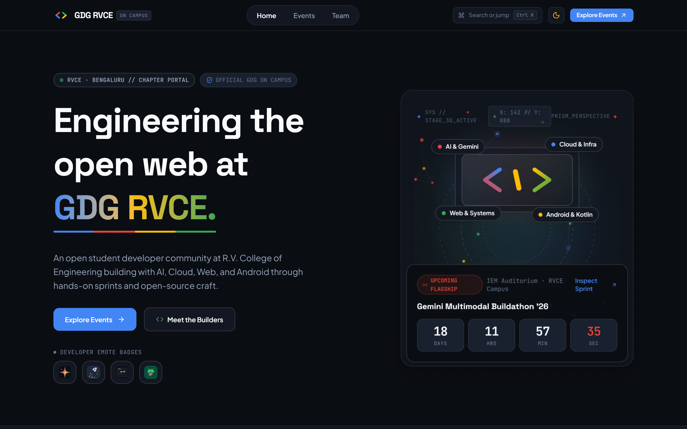
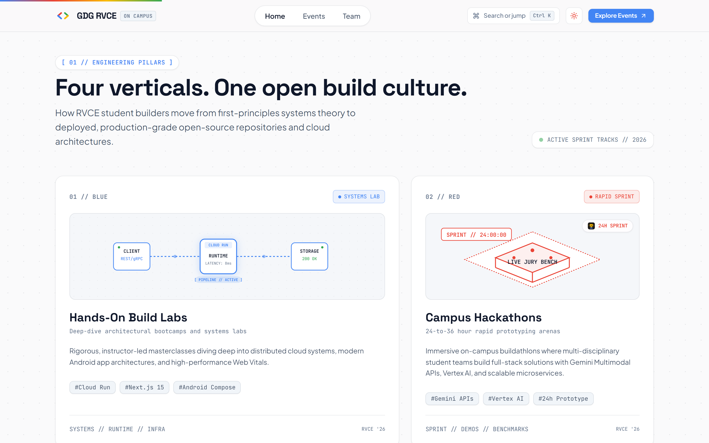
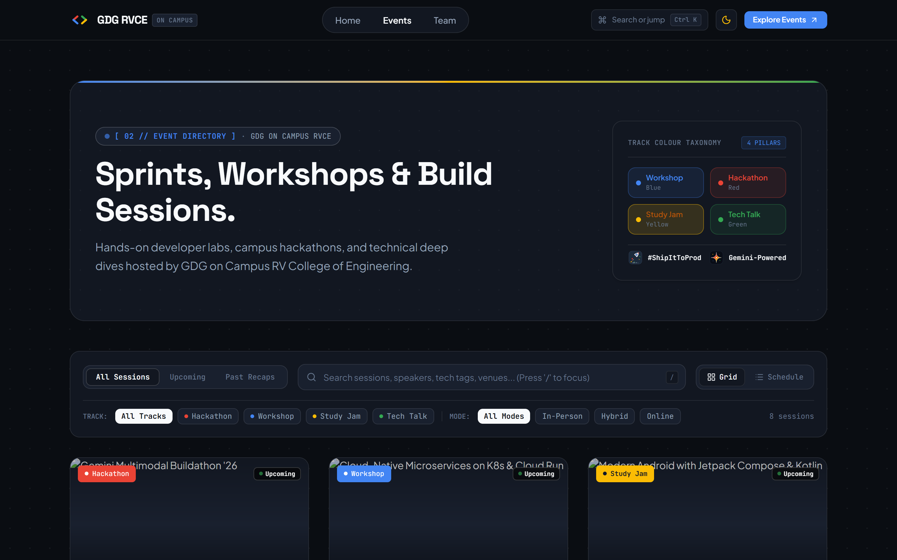
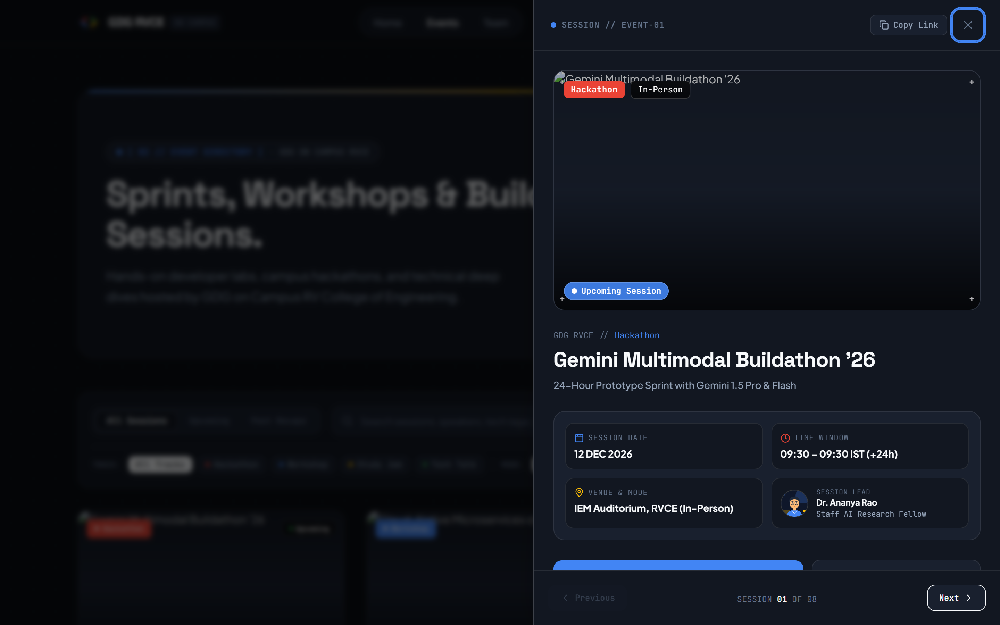
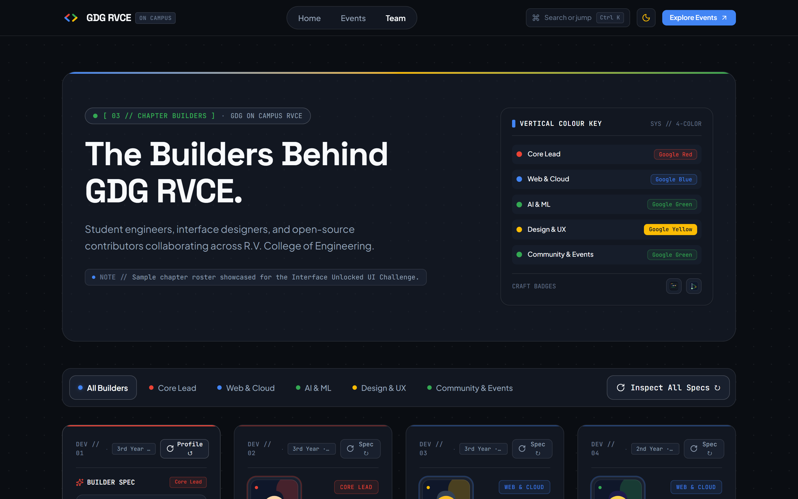
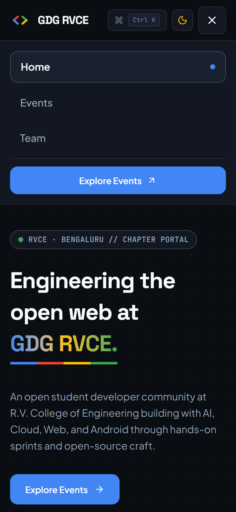

# GDG on Campus RV College of Engineering (GDG RVCE)
## Interface Unlocked UI Design Challenge

[](https://nextjs.org/)
[](https://react.dev/)
[](https://tailwindcss.com/)
[](https://www.typescriptlang.org/)
[](https://www.w3.org/WAI/standards-guidelines/wcag/)
[](https://opensource.org/licenses/MIT)

---

### 🌐 Live Deployment & Repository Links
* **Live Deployment:** [https://gdg-rvce-interface-unlocked.vercel.app](https://gdg-rvce-interface-unlocked.vercel.app)  
  *(Note: Update URL if deployed to a custom Vercel domain or alternative production host).*
* **GitHub Repository:** [https://github.com/Code-with-Prabhjot/gdg-rvce-interface-unlocked](https://github.com/Code-with-Prabhjot/gdg-rvce-interface-unlocked)

---

## 📐 Project Description & Design Vision

Built for the **Interface Unlocked UI Design Challenge**, this platform is the official digital surface for **GDG on Campus RV College of Engineering (GDG RVCE)**.

Rather than recycling generic corporate landing page tropes or superficial glassmorphic cards, the design is anchored in an **"Architectural Blueprint & Kinetic Canvas"** philosophy. Inspired by Swiss graphic precision, technical drafting schematics, and code-native IDEs, the interface reflects RVCE’s rigorous engineering culture.

### Core Architectural Tenets:
1. **Precision Dual-Theme Engine:**
   - **Obsidian IDE (`dark`):** Deep `#0A0D12` developer editor palette accented by vivid Google brand light emitters, terminal command inputs, and laser-sharp hairlines. Zero-flash synchronous client boot.
   - **Daylight Blueprint (`light`):** Architectural drafting table `#FAFAFB` canvas with 32px coordinate dot grid, technical dimension lines, and tactile ink contrast.
2. **Strict Brand Compliance & Community Independence:**
   - Faithful execution of the official **Google Developer Groups `< >` chevron emblem**.
   - Universal semantic deployment of the **4 official Google colours** (`#4285F4`, `#EA4335`, `#FBBC04`, `#34A853`).
   - Yellow elements (`#FBBC04`) are universally mapped to `#111827` dark ink on fills, securing **>7:1 WCAG AAA** contrast.
   - Explicit independence disclaimer in the global footer: *"GDG on Campus RVCE is an independent student developer community and is not an official Google product."*
3. **Ground-Rule Integrity:**
   - **Exact Route Scope:** Exclusively `/` (Home), `/events` (Events & Sprints), `/team` (Core Team), and `not-found.tsx` under `src/app/`.
   - **Zero Prohibited Trackers:** Strictly no analytics counters, no RSVP / interest counters (`"X people going"`), no attendee rosters, no live comment feeds, and no chat widgets.
   - **100% Fictional Data:** All speakers, agenda schedules, and team specs are curated fictional samples.

---

## 📸 Visual Showcase (Production Viewports)

| Viewport / Page | Preview | Key Architectural Elements |
|---|---|---|
| **01. Home (Obsidian Dark)**<br>`1440x900` |  | Kinetic Split Hero, HTML5 Constellation Canvas, 3D mouse-tilt GDG Prism Stage, Live Flagship Hackathon Countdown. |
| **02. Bento Pillars (Daylight Light)**<br>`1440x900` |  | 4-Pillar Architectural Bento Grid (AI/ML, Cloud, Android, Open Source), Interactive Emotes, Technical Specs. |
| **03. Events Directory**<br>`1440x900` |  | Real-time `/` search, multi-axis filters (Track, Status, Delivery Mode), Grid / Schedule List toggle, 16:9 vector artwork. |
| **04. Event Detail Drawer**<br>`1440x900` |  | Deep-dive slideover, 4-colour agenda timeline, interactive readiness checklist, sample pass confirmation, `.ics` calendar export. |
| **05. Team & Builder Specs**<br>`1440x900` |  | Vertical department filter bar, Bauhaus geometric portraits, and inspected dual-sided Builder Spec card (`Spec ↻`). |
| **06. Mobile Responsive**<br>`375x812` |  | Zero horizontal overflow, accessible mobile navigation drawer, thumb-friendly tap targets, high-contrast badges. |

---

## ⚡ Key Features Across the Three Core Pages

### 1. Home Page (`/`)
* **Interactive HTML5 Constellation Canvas:** High-performance particle physics engine reacting to cursor proximity with Google 4-colour connection filaments.
* **3D Mouse-Tilt GDG Prism Stage:** Geometric `< >` chevron floating stage with real-time perspective distortion (`rotateX`, `rotateY`, dynamic specular glares) driven by mouse pointer velocity.
* **Live Flagship Sprint Countdown:** High-contrast countdown timer ticking live towards RVCE's next flagship buildathon with microsecond precision.
* **Campus Telemetry & Tech Marquee:** Real-time engineering telemetry bar featuring RVCE GPS coordinates (`12.9237° N, 77.4987° E`), active build cycle, and infinite marquee of modern tools (Gemini 2.5 Pro, Firebase Genkit, Vertex AI, Ktor, Jetpack Compose).
* **Asymmetric 4-Pillar Bento Grid:** Interactive architectural modules exploring GDG RVCE's four disciplines—AI/ML, Cloud & DevOps, Android & Mobile, and Web & Open Source—with interactive developer sticker badges.
* **Featured Upcoming Sprints & Recap Spotlight:** Curated event cards and an interactive multi-tab community recap highlighting previous DevFest keynotes and student hackathon milestones.

### 2. Events & Sprints Directory (`/events`)
* **Real-Time `/` Instant Search:** Keyboard-shortcut-focused input filtering titles, topics, speakers, and venues without layout thrashing.
* **Multi-Axis Filter Bar:** Simultaneous filtering by Event Status (*All, Upcoming, Live, Past*), Technology Track (*AI/ML, Cloud, Android, Web*), and Delivery Mode (*In-Person, Hybrid, Virtual*).
* **Grid vs. Schedule List Toggle:** Switch effortlessly between architectural 16:9 vector illustration cards and a structured chronological schedule view.
* **Bidirectional URL Query Sync:** Filters and selected event slugs sync with the browser URL (`?event=...&track=...`), enabling seamless sharing and bookmarking.
* **Deep-Dive Event Detail Drawer:**
  - **4-Colour Agenda Timeline:** Micro-stepper rendered in Google Blue, Red, Yellow, and Green.
  - **Interactive Readiness Checklist:** Local browser-persisted checklist ensuring attendees prepare their dev environment before arriving.
  - **Sample Pass Generator:** Interactive modal with barcode simulation and pass confirmation.
  - **Client-Side `.ics` Calendar Export:** One-click instant calendar export generating compliant RFC 5545 iCalendar files.

### 3. Core Team Directory (`/team`)
* **Vertical Department Filter Bar:** Filter builders by engineering vertical (*All, Chapter Leads, Machine Learning, Cloud & Infrastructure, Mobile & Edge, Systems & Open Source*).
* **Dual-Sided Tactile Builder Cards:**
  - **Front (Profile):** Custom Bauhaus geometric vector portraits, academic year and branch, role badges, and social links.
  - **Back (Builder Spec ↻):** Flipped view revealing technical stacks (e.g., Python, JAX, PyTorch), active projects, and GitHub commit activity badges.
* **Open Build Workflow Strip:** Four-step engineering workflow documenting how RVCE student contributors propose, prototype, review, and ship open-source software.

### 4. Developer Craft & Universal Accessibility
* **`⌘K` / `Ctrl+K` Command Palette:** Fuzzy command execution for rapid page navigation, theme toggling, quick search, and confetti celebrations.
* **`` ` `` / `~` Interactive Developer CLI Terminal:** Quake-style drop-down terminal executing commands (`help`, `clear`, `theme`, `events`, `team`, `coords`, `status`).
* **Physics-Based Spring Micro-Interactions:** Magnetic button pulls, smooth scale damping, and tactile `:active` states.
* **Universal Keyboard Navigation & WCAG AAA Compliance:** Every interactive element features high-visibility `:focus-visible` rings and explicit ARIA labels.
* **`prefers-reduced-motion` Support:** Automatically bypasses heavy parallax and particle physics for users who prefer minimal motion.

---

## 🛠️ Technologies Used

| Layer | Technology | Purpose |
|---|---|---|
| **Framework** | **Next.js 15.5 (App Router)** | Server Components, static site pre-rendering, modern routing |
| **Library** | **React 19.1** | Modern hook architecture, concurrent UI transitions |
| **Language** | **TypeScript 5** | Strict type safety, interface contracts for all data structures |
| **Styling** | **Tailwind CSS v4** | CSS variables, container queries, high-performance styling engine |
| **Motion** | **Framer Motion 14** | Spring physics, layout animations, gestures, and drawer transitions |
| **Icons** | **Lucide React & Phosphor Icons** | Clean, accessible developer and system iconography |
| **Visual Assets** | **Node.js SVG Generator** | Bespoke local vector engine (`scripts/generate-visual-assets.mjs`) |
| **Effects** | **Canvas Confetti** | Google 4-colour particle celebrations |

---

## 🚀 Local Setup & Build Instructions

### 1. Clone the Repository
```bash
git clone https://github.com/Code-with-Prabhjot/gdg-rvce-interface-unlocked.git
cd gdg-rvce-interface-unlocked
```

### 2. Install Dependencies
```bash
npm install
```

### 3. Generate Local Vector Assets
Generate the 31 local, self-contained SVG assets (GDG mark, 12 developer emotes, 8 event covers, 10 Bauhaus developer avatars):
```bash
npm run assets:build
```

### 4. Start Local Development Server
```bash
npm run dev
```
Open [http://localhost:3000](http://localhost:3000) in your browser.

### 5. Production Build & Lint Check
```bash
npm run lint
npm run build
npm run start
```

---

## 📜 Credits & Open-Source Attributions

* **Typography:**
  - [Space Grotesk](https://fonts.google.com/specimen/Space+Grotesk) by Florian Karsten (SIL Open Font License)
  - [Plus Jakarta Sans](https://fonts.google.com/specimen/Plus+Jakarta+Sans) by Tokotype (SIL Open Font License)
  - [JetBrains Mono](https://www.jetbrains.com/lp/mono/) by JetBrains (Apache License 2.0)
* **Iconography:**
  - [Lucide Icons](https://lucide.dev/) (ISC License)
  - [Phosphor Icons](https://phosphoricons.com/) (MIT License)
* **Animation & Visuals:**
  - [Framer Motion](https://www.framer.com/motion/) by Framer (MIT License)
  - [Canvas Confetti](https://github.com/catdad/canvas-confetti) by Kiril Vatev (ISC License)
* **Vector Art & Assets:**
  - All 31 vector illustrations, Bauhaus portraits, and event covers were authored specifically for this submission via `scripts/generate-visual-assets.mjs`.

---

## ⚖️ Legal & Community Disclaimer
GDG on Campus RVCE is an independent student developer community at RV College of Engineering and is not an official Google product or corporate entity. Google Developer Groups, Google, and the Google logo are trademarks of Google LLC.
